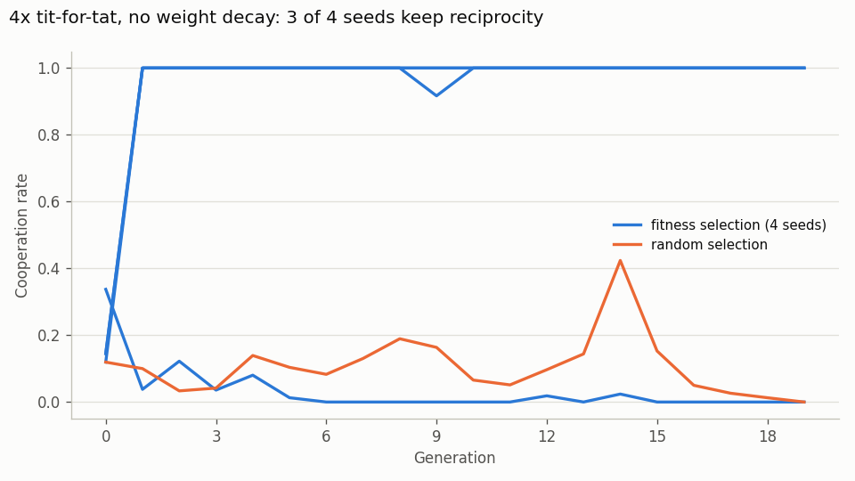

# The Selfish LoRA

Can evolution teach a language model to cooperate? This project breeds AI
agents by natural selection and watches which strategies appear when they
play a classic cooperation game against each other.

Every agent is the same small language model (Qwen2.5-0.5B-Instruct) plus
its own small set of extra weights, which act as its "genome". Agents play
the iterated prisoner's dilemma. The highest scorers become parents: their
genomes are mixed and randomly mutated to make the next generation. Evolution
uses no gradient training: selection is the only thing that changes the
agents.

It runs on a 4 GB laptop GPU, and each run takes under an hour or so. Full
write-up with figures: [docs/RESULTS.md](docs/RESULTS.md).

## Key terms

- **Iterated prisoner's dilemma:** two players repeatedly choose to
  *cooperate* or *defect*. Both cooperating earns 3 points each; both
  defecting earns 1 each; a defector facing a cooperator earns 5 and the
  cooperator 0. Defecting wins any single round, but mutual cooperation
  pays more over many rounds.
- **Tit-for-tat:** cooperate first, then copy the opponent's last move. A
  simple, famous strategy that rewards cooperation and punishes defection.
- **Always-defect:** never cooperate. The unmodified model plays this.
- **Genome (LoRA adapter):** about 98,000 extra numbers added to the
  model's weights. Different genomes make the model play differently.
- **Control run:** the same setup, but parents are picked at random instead
  of by score. It shows what happens by chance alone.
- **Weight decay:** each generation, every new genome is pulled part of the
  way back towards a fixed reference genome, so random mutations can't pile
  up forever.
- **Seed:** the random starting point of a run. Repeating a result on
  several seeds shows it isn't luck.

## Findings



1. **Selection changes behaviour.** Against fixed opponent bots, evolution
   turns the model's always-defect into cooperation. In control runs,
   mutations pile up until the model's replies stop making sense.
2. **The opponents decide what evolves.** Against bots that reward
   cooperation, cooperation evolves. When agents play only each other, they
   stay selfish.
3. **Evolution finds tricks, not tit-for-tat.** In five runs it found
   strategies that count rounds (one cooperated for five rounds, then
   defected in the last), never ones that react to the opponent.
4. **Yet tit-for-tat is easy for the model to learn.** Trained directly
   with gradient descent, the same small genome plays perfect tit-for-tat,
   with far smaller weight changes than evolution makes. Evolution's
   problem is finding it, not representing it. Findings 5-7 plant copies of
   this trained genome in a starting population to test what evolution
   does with tit-for-tat once it exists.
5. **Tit-for-tat needs enough company.** In a population of 12 otherwise
   defecting agents, 1 or 2 copies die out; 4 copies take over in a single
   generation.
6. **Selection keeps tit-for-tat once it has a foothold.** With no weight
   decay, it held for 19 generations in all 3 seeds where it started as the
   top scorer. In control runs it was lost in all 4 seeds.
7. **What weight decay pulls towards decides the outcome.** Pulling genomes
   back towards the original model, itself an always-defector, destroyed
   tit-for-tat in all 3 seeds within about 8 generations. Pulling towards
   tit-for-tat keeps it, even in control runs.
8. **Countdown** (a second task, arithmetic puzzles): no improvement over
   the control, so it is paused.

**In short:** selection on a language model's weights can keep cooperation
going, but did not discover it. And there is no neutral starting point: the
original model already plays a strategy (always-defect), so anything that
pulls towards it pulls towards that strategy.

Limits: one small model, populations of 12-16, 1-4 seeds per condition.

## Related work

Evolving prisoner's dilemma strategies is an old idea: in the 1980s
Axelrod's genetic algorithm evolved tit-for-tat-like rules from scratch.
Recent work uses language models as players or strategy writers, or
trains their weights with reinforcement learning. The closest method,
[PopuLoRA](https://arxiv.org/abs/2605.16727), also mutates and crosses
LoRA weights, but alongside gradient training and for coding tasks. As far
as we know, evolving a language model's own weights by selection alone in
a social game hasn't been reported. References and details:
[docs/RESULTS.md, Related work](docs/RESULTS.md#related-work).

## Layout

```
src/selfish_lora/          shared machinery used by every experiment
  model.py                 load base model + LoRA adapter
  genome.py                genome = dict of LoRA B tensors; load into model
  evolution.py             initial population, selection, crossover, mutation
  generate.py              batched greedy generation
  runlog.py                per-generation history.jsonl + plots
  checkpoint.py            save/restore runs between generations

experiments/
  prisoners_dilemma/       multi-agent: iterated prisoner's dilemma tournament
    run.py                 evolve genomes (bots, self-play, seeding, decay)
    train_reference.py     gradient-train a genome on a known strategy
    fingerprint.py         a genome's move in every short history
  countdown/               single-agent skill: arithmetic puzzles (paused)
  plans/                   the experiment batches behind each result
  compare_runs.py          overlay metrics from several runs
  calibrate_mutation.py    how much noise changes behaviour
  run_queue.py             run a plan, resuming after interruptions

docs/RESULTS.md            results log, related work, limitations
```

## The two experiments

| | Countdown | Prisoner's dilemma |
|---|---|---|
| Question | Can evolution improve a single-agent skill? | Do known evolutionary dynamics emerge between LLM agents? |
| Fitness | reasoning-gym score on a shared batch of puzzles | Average payoff per round in a round-robin tournament |
| Base model | 6% exact on held-out puzzles | Always defects |
| Look for | Held-out score rising above the base model | Shift from always-defect towards reciprocity (cooperation, retaliation) |
| Status | Paused (null result) | Main experiment |

Run an experiment, then the same thing with `--control` (identical but selection is random) and compare:

```bash
.venv/Scripts/python experiments/prisoners_dilemma/run.py --generations 20 --run-name evolved_s0
.venv/Scripts/python experiments/prisoners_dilemma/run.py --generations 20 --run-name control_s0 --control
.venv/Scripts/python experiments/compare_runs.py experiments/prisoners_dilemma/runs/evolved_s0 \
    experiments/prisoners_dilemma/runs/control_s0 --metrics coop_rate --ylabel "Cooperation rate"
```

To reproduce a result, run its plan (e.g. the headline Batch D). It needs
the gradient-trained tit-for-tat genome first:

```bash
.venv/Scripts/python experiments/prisoners_dilemma/train_reference.py --strategy tft --batch 4 --steps 300 --lr 5e-4
.venv/Scripts/python experiments/run_queue.py experiments/plans/batch_d_no_decay.json
.venv/Scripts/python experiments/prisoners_dilemma/fingerprint.py --population runs/nodecay_tft4_s0
```

Each run writes `config.json`, `history.jsonl`, `checkpoint.pt`, `best.pt` and
`fitness.png` to `experiments/<name>/runs/<run-name>/` (a timestamped name if
`--run-name` is not given).

## Resuming after an interruption

Runs checkpoint after every generation (population, settings and random
number generator states), so a resumed run produces exactly the same results
as an uninterrupted one. Re-run the same command with the same `--run-name`
to continue; a finished run just exits.

For a batch of runs, list them in a plan file and use the queue runner. After
a reboot or closed lid, run the same command again: finished runs are skipped
and the interrupted one resumes.

```bash
.venv/Scripts/python experiments/run_queue.py experiments/plans/<plan>.json
.venv/Scripts/python experiments/run_queue.py experiments/plans/<plan>.json --status
```

Closing the lid usually just pauses the process (sleep); a shutdown or
hibernate kills it, and the queue command picks it back up.

## Design choices

- **Only LoRA B matrices evolve.** A is fixed at PEFT's random init and shared, so a
  mutation to B changes behaviour directly. Evolving A and B from zero (as the
  original gridworld did) makes small mutations almost invisible.
- **Same inputs for everyone.** All genomes in a generation see the same puzzles or the
  same tournament, so fitness differences come from the weights.
- **The base genome is in generation 0**, so the best fitness never starts below the base model.
- **Always run a control.** Without one you can't tell evolution from noise.
- **Invalid replies count as defection and score 0**, so broken genomes
  can't be exploited. Later batches draw random match lengths
  (`--rounds-max`), so there is no known last round.
- **Weight decay is optional and not neutral.** `--weight-decay` bounds
  mutation build-up by pulling children towards the base model (or, with
  `--decay-to seed`, a seed genome); that target biases the outcome (Batch C).

## Setup

```bash
pip install -r requirements.txt
```

Put `HF_TOKEN=...` in `.env` at the repo root if your model needs it.

## Project history

The project began as a 16x16 gridworld where LoRA agents moved around,
collected food and fought, with a fine-tuning pipeline to give them a
starting behaviour. It had too many moving parts to tell what evolution was
actually doing, so it was narrowed to small games with clear baselines and
controls: the prisoner's dilemma and Countdown. The gridworld code is kept
at the [`gridworld-archive`](https://github.com/ljcarey123/the-selfish-lora/tree/gridworld-archive/legacy/gridworld)
tag.

## Future work

A possible follow-on, in a separate repository, would study these dynamics
in a spatial world with resources: [docs/NEXT_PROJECT.md](docs/NEXT_PROJECT.md).
It is a proposal only and not part of this project.
