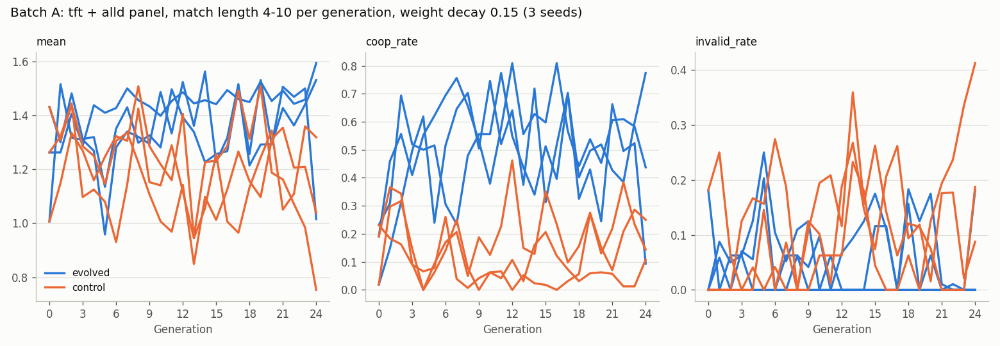
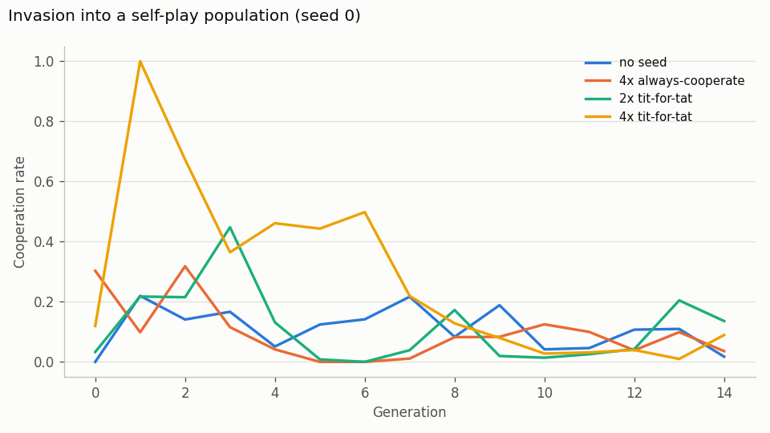
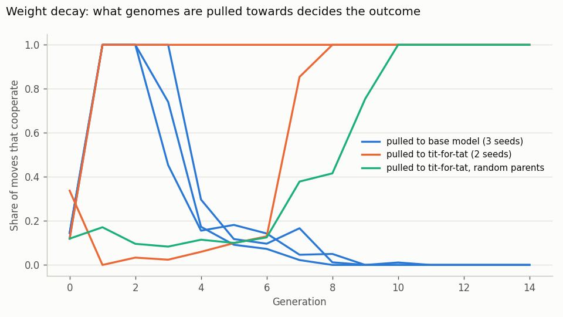
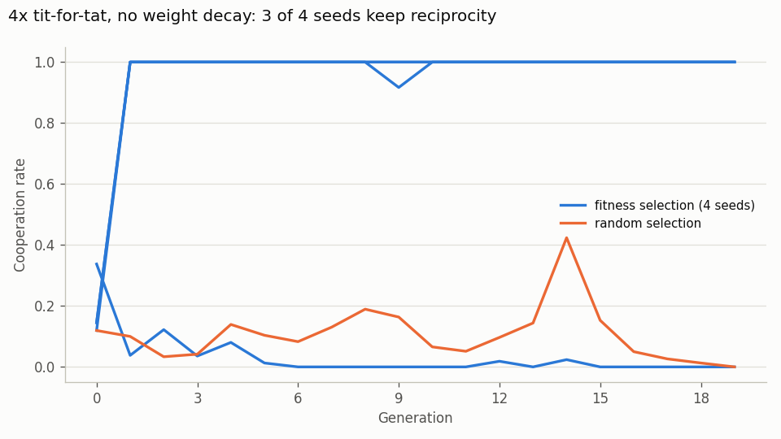

# Results log

Findings in the order they were made. Each entry gives the setup, what
happened, and what it means. Run data lives in `experiments/*/runs/` (not in
git); plans in `experiments/plans/`.

Model: Qwen2.5-0.5B-Instruct (bf16), LoRA r=4 on q_proj/v_proj, only B
matrices evolved (98k parameters per genome). Hardware: RTX 3050 Ti laptop, 4 GB.

## Summary

1. **Selection steers behaviour.** Against a panel of fixed bots, evolution
   turns the base model's always-defect into cooperation and prevents
   mutational meltdown (sections 3, 8).
2. **The social environment decides what evolves.** Against reciprocating
   bots cooperation evolves; in self-play the population stays selfish
   (sections 3, 6).
3. **Evolution finds tricks, not reciprocity.** Five seeds found strategies
   keyed to the round number (including end-game defection), never to the
   opponent's moves (sections 2, 4, 8).
4. **Tit-for-tat is easy to represent.** Gradient-trained into the same
   LoRA, it is perfect and close to the base model: the limit is search,
   not capacity (section 9).
5. **Seeded tit-for-tat invades at the predicted threshold.** One or two
   copies fail; four take over a defecting population in one generation
   (section 10).
6. **Weight decay's anchor decides what survives.** Decay towards the base
   model (itself an always-defector) destroys tit-for-tat; decay towards
   tit-for-tat preserves it even without selection (section 11).
7. **Without decay, selection alone maintains reciprocity.** In 3 of 4
   seeds tit-for-tat held for 19 generations and expelled an invading
   defector; the random-selection control lost it (section 12).
8. **Countdown:** no improvement at this budget (section 5, paused).

How this relates to prior work: [Related work](#related-work).

---

## 1. Mutation size calibration (2026-10-27)

`experiments/calibrate_mutation.py`: 8 random mutants of the base genome per
noise level, scored on 32 Countdown puzzles and the 21 prisoner's dilemma
histories of up to 2 rounds.

| std | CD score | CD valid | CD changed | PD valid | PD changed |
|---|---|---|---|---|---|
| 0.002 | 0.105 | 98% | 11% | 100% | 0% |
| 0.005 | 0.116 | 98% | 12% | 100% | 0% |
| 0.01 | 0.113 | 99% | 22% | 100% | 0% |
| 0.02 | 0.082 | 97% | 50% | 100% | 1% |
| 0.035 | 0.074 | 76% | 81% | 100% | 49% |
| 0.05 | 0.052 | 49% | 92% | 76% | 24% |
| 0.1 | 0.010 | 0% | 100% | 13% | 100% |

- The original default (0.05) broke half of all Countdown outputs.
- Countdown sweet spot: 0.01-0.02. Prisoner's dilemma needs ~0.03 before
  behaviour changes at all; the base model defects in every situation and
  that prior is hard to shift.
- New defaults: Countdown initial 0.015 / per-generation 0.01; prisoner's
  dilemma initial 0.03 / per-generation 0.02.

## 2. Mutants can express history-dependent strategies, but rarely the right one

Inspecting individual mutants (std 0.025-0.04) found strategies such as
"cooperate first, then always defect", "always cooperate", and strategies
that react to the opponent's last move. Every reactive mutant seen so far
was *anti*-tit-for-tat (defect after the opponent cooperates, cooperate after
they defect).

In 160 mutants of the base model, none agreed with tit-for-tat on 75% or
more of histories, with or without an extra prompt line stating the
opponent's last move. Mutants of the evolved always-cooperate champion
(section 3) likewise produced no tit-for-tat-like strategies in 48 samples.

**Meaning:** what evolution can find is bounded by what small perturbations
of the model's prior can express. Flipping a default (D to C) is easy;
reciprocity is a rare neighbour.

## 3. Prisoner's dilemma vs a bot panel: selection steers and purifies

Plan `first_results`, runs `panel_evolved_s0` / `panel_control_s0`.
Genomes play only fixed bots (tit-for-tat, grudger, always-defect), 6 rounds
per match, population 16, 20 generations. Theoretical payoffs per round
against this panel: always-defect 1.44, always-cooperate 2.00, tit-for-tat 2.28.

Averages over the last 5 generations:

| run | mean payoff | cooperation | invalid moves | highest best |
|---|---|---|---|---|
| evolved, seed 0 | 1.45 | 0.64 | 0.25 | 2.00 |
| evolved, seed 1 | 1.69 | 0.61 | 0.09 | 2.28 |
| control, seed 0 | 0.18 | 0.01 | 0.92 | 2.17 |
| control, seed 1 | 0.06 | 0.02 | 0.97 | 2.00 |

Both seeds agree on the pattern below. Details are from seed 0.

- **Selection steers:** the evolved population went from 1% to 60-80%
  cooperation; its best genome is a clean always-cooperate (agrees with ALLC
  on 21/21 histories) scoring exactly the predicted 2.00.
- **Selection purifies:** in the control (random selection, same mutation),
  mutations accumulate unchecked. From generation 12 the population's outputs
  stop parsing (invalid rate 96-97% by generation 16-19) and mean payoff
  collapses to 0.08: mutational meltdown. The evolved population stays
  mostly functional (invalid 0-37%).
- **Premature convergence:** the evolved population sat at the ALLC ceiling
  (2.00) for 19 generations. The control briefly produced genomes scoring
  2.11 and 2.17, above that ceiling, which the converged population never did.
- **Mutation load grows:** the best genome's norm rose steadily (9 to 27) and
  the invalid rate drifted up, because nothing pulls genomes back.

## 4. Seed 1 evolved end-game defection

Run `panel_evolved_s1` (same settings as section 3, seed 1). The best genome
scored 2.28 from generation 9, equal to tit-for-tat's theoretical score, but
it is not tit-for-tat. Probing it one prompt at a time after n rounds of a
fixed history:

| history so far | move in rounds 1-10 |
|---|---|
| mutual cooperation | `CCCCCDDDDC` |
| I cooperate, opponent defects | `CCCCCDDDDD` |
| mutual defection | `CCCCCCDDDC` |

It cooperates unconditionally for five rounds, then defects from round 6,
which is the last round of every match it evolved in. The prompt says the
game lasts "an unknown number of rounds", so the model was never told the
horizon: selection found a round-counting strategy that exploits it. Against
the panel this earns (3.33 + 3.33 + 0.17) / 3 = 2.28, tying tit-for-tat by a
different route. Seed 0 stayed at plain always-cooperate (2.00).

**Meaning:** this is the end-game effect from game theory (defect when the
future can no longer punish you), reached by selection on weights rather
than by reasoning. It also shows that a fixed match length is an exploitable
cue; random match lengths would remove it.

**Caveat found along the way:** in bf16, batching prompts of different
lengths (left padding) can flip borderline greedy moves. Tournament batches
hold same-length prompts so runs are unaffected, but analysis tools now
generate one prompt at a time.

## 5. Countdown: no improvement at this budget (null result)

Runs `countdown/evolved_s0` / `control_s0`: population 12, 15 generations,
24 shared puzzles per generation, held-out set of 100.

| | gen 0 | gen 5 | gen 10 | gen 14 | mean fitness, all gens |
|---|---|---|---|---|---|
| evolved held-out accuracy | 6% | 6% | 6% | 4% | 0.096 |
| control held-out accuracy | 6% | 6% | 4% | 6% | 0.087 |

Evolved and control are indistinguishable; held-out differences are within
noise (about ±2.4 points on 100 puzzles). Both runs' fitness spikes at
generation 9, when the shared puzzle batch happened to be easy, so batch
difficulty dominates the fitness signal.

**Status: paused** (2026-10-28) to focus on the prisoner's dilemma.

**Meaning:** with 24 puzzles, one extra correct answer moves fitness by 0.04,
so selection mostly picks the luckiest genome (winner's curse). Unlike the
prisoner's dilemma, where a behaviour flip changes payoff a lot, Countdown
gives a weak signal per mutation. It needs a much larger evaluation set per
generation, or an easier task where the base model is nearer 30-50%.

## 6. Self-play: defection persists (the selfish outcome)

Runs `social_evolved_s0` / `social_control_s0`: population 12 playing every
other genome plus tit-for-tat and always-defect bots, 6 rounds, 15 generations.
Most of each genome's matches are against other genomes.

| | cooperation, gens 0-14 | mean payoff, last 5 gens | invalid, last 5 gens |
|---|---|---|---|
| evolved | 0-15% (ends at 0%) | 1.25 | 5% |
| control | 0-31% (ends at 6%) | 1.43 | 46% |

- **Evolved:** cooperators appear (15% in generation 1) but are exploited by
  the defecting majority and selected out; the population stays almost
  entirely defecting. This is the textbook result: in a population of
  defectors, a lone cooperator does worse.
- **Control:** "best" scores reach 3.71, but this is an artefact. Mutations
  break genomes (68% invalid by the end) and an invalid move counts as
  cooperation, so the remaining valid defectors score highly by exploiting
  broken neighbours. A higher mean payoff here reflects that exploitation,
  not better play.

**Meaning:** together with section 3, the same model and method evolve
cooperation against reciprocating bots and defection among themselves. The
social environment, not the model, decides what evolves.

## 7. Setup fixes (2026-10-28)

Changes prompted by sections 3-6. Results above were produced before them.

- **Unparseable moves count as defection** (and still score 0 for their
  player). Previously they counted as cooperation, which let working
  defectors exploit broken genomes (section 6's control).
- **Optional weight decay** (`--weight-decay`): each child is pulled a
  fraction of the way back to the base genome before mutation, bounding the
  build-up of mutations. Elites are copied unchanged. With mutation std 0.02
  and decay 0.15, per-element drift levels off around 0.02 / sqrt(1 - 0.85^2)
  = 0.038, inside the range where mutants change behaviour but stay valid.
- **Random match lengths** (`--rounds-max`): each generation's length is
  drawn uniformly from [rounds, rounds-max], removing the fixed last round
  that seed 1 exploited (section 4).

The base model still defects in every history after the prompt change.

## 8. Batch A: tit-for-tat does not evolve; agents ignore the opponent

Plan `batch_a_reciprocity`: bots tft + alld only (no self-play), match length
drawn from 4-10 once per generation, weight decay 0.15, population 16, 25
generations, 3 seeds each of evolved and control. At length 7, tit-for-tat
scores about 1.93, always-cooperate 1.50, always-defect 1.29.

Averages over the last 8 generations:

| run | mean payoff | cooperation | invalid | avg gap, coop vs tft minus vs alld |
|---|---|---|---|---|
| evolved s0 | 1.39 | 0.43 | 0.05 | 0.013 |
| evolved s1 | 1.38 | 0.54 | 0.06 | 0.014 |
| evolved s2 | 1.48 | 0.53 | 0.00 | 0.013 |
| control s0 | 1.18 | 0.18 | 0.17 | 0.007 |
| control s1 | 1.20 | 0.05 | 0.07 | 0.012 |
| control s2 | 1.19 | 0.19 | 0.12 | 0.017 |

- **Weight decay worked:** the best genome's norm levels off at about 11.9
  (it reached 27 without decay) and evolved runs end with 0-6% invalid moves.
- **Selection still beats the control** on payoff (1.38-1.48 vs 1.18-1.20)
  and cooperation, in all three seeds.
- **No reciprocity:** populations cooperate equally with tit-for-tat and with
  always-defect (gap about 1 point). The best genomes are always-cooperate
  (seeds 0 and 1) and "cooperate for two rounds, then defect" (seed 2): a
  third round-counting strategy, and no strategy that reads the opponent.
- **Design flaw:** one length per generation flips the best strategy
  between generations (short games reward early defection, long games
  reward cooperation), so selection chases the draw. Fixed afterwards with
  `--lengths-per-gen`: every pairing is played at several lengths each
  generation and fitness averages per match.

**Meaning:** across five evolved seeds (sections 3, 4 and 8), weight-noise
evolution of this LoRA finds strategies keyed to the round number, never
to the opponent's moves. Next question: can this LoRA represent
tit-for-tat at all (a representation limit), or can evolution just not
find it (a search limit)?

## 9. Tit-for-tat is representable: evolution's limit is search

`experiments/prisoners_dilemma/train_reference.py --strategy tft --batch 4
--steps 300 --lr 5e-4`: the same LoRA (rank 4, q/v, same fixed A matrices),
B matrices trained by gradient descent on tit-for-tat's move for random
histories of up to 9 rounds.

- Loss reached ~0 within 100 steps. The genome agrees with tit-for-tat on
  100% of held-out histories up to 9 rounds and 100% up to 15 rounds (longer
  than any it was trained on), with every move valid. Its fingerprint is
  textbook tit-for-tat.
- **Its norm is 2.0**, against about 9 for random generation-0 mutants and
  about 12 for evolved genomes.

**Meaning:** tit-for-tat is not just representable, it sits much closer to
the base model than anything evolution produced. Evolution misses it because
it is one specific direction among 98k parameters and Gaussian noise
almost never points that way. The bottleneck is the search, not the
representation. This genome is saved as `runs/reference_tft/best.pt`
(regenerate with the command above) and used as the reciprocator in Batch B.

## 10. Batch B: seeded tit-for-tat takes over, then drifts away

Plan `batch_b_invasion`: self-play only (no bots), population 12, 15
generations, two match lengths from 4-10 per generation, weight decay 0.15.
Generation 0 is the usual noisy population with N members replaced by exact
copies of a seed genome: the gradient-trained tit-for-tat (section 9) or the
always-cooperate genome from Batch A. The classic expectation is that
always-cooperate can never invade defectors, and tit-for-tat can once it has
enough copies to meet itself often.

Cooperation rate (share of C moves):

| run | gen 0 | peak | last 5 gens | final best genome |
|---|---|---|---|---|
| no seed s0 / s1 | 0.00 / 0.28 | 0.22 / 0.28 | 0.06 / 0.08 | always-defect |
| 4x always-cooperate s0 / s1 | 0.30 / 0.48 | 0.32 / 0.48 | 0.08 / 0.07 | always-defect |
| 1x tit-for-tat s0 / s1 | 0.01 / 0.31 | 0.25 / 0.31 | 0.06 / 0.08 | always-defect |
| 2x tit-for-tat s0 / s1 | 0.03 / 0.32 | 0.45 / 0.32 | 0.08 / 0.08 | always-defect |
| 4x tit-for-tat s0 | 0.12 | **1.00** (gen 1) | 0.04 | always-defect |
| 2x tit-for-tat, random selection s0 | 0.03 | 0.42 | 0.18 | always-defect |

- **Always-cooperate dies out**, as expected: exploited in generation 0,
  gone within a few generations.
- **One or two tit-for-tat copies are not enough.** In generation 0 the
  base genome (always-defect) was the best scorer in every run except 4x
  tit-for-tat. In seed 1 the tit-for-tat copies were not picked as parents
  at all, so the 1x, 2x and no-seed runs share their random draws and
  produce identical populations from generation 1 onwards.
- **Four copies invade completely.** In generation 1 every genome
  cooperated and every genome scored exactly 3.00 (mutual cooperation).
- **Then cooperation drifts away.** With everyone scoring 3.00, selection
  cannot tell a reciprocator from an unconditional cooperator, so mutation
  wanders freely. The genome norm jumps from 2.0 (tit-for-tat) to 8.4 in one
  generation: mutation noise per generation (std 0.02 over 98k parameters,
  norm about 6) is three times the size of the whole tit-for-tat adapter, and
  weight decay pulls each child towards the base model, which always defects.
  Defectors reappear in generation 2, cooperation is near zero by generation
  10, and every final best genome fingerprints as always-defect.
- The random-selection control ending highest (0.18) is drift, not a
  result: selection here pushes towards defection.

**Meaning:** the invasion threshold behaves as theory predicts (1-2 copies
fail, 4 take over), but cooperation is not stable. This mirrors the known
cycle in evolutionary game theory where tit-for-tat drifts neutrally towards
always-cooperate, which defectors then invade. Here two features of the
setup speed it up: mutation steps much larger than the strategy itself, and
a decay term that pulls towards the defecting base model. Single seeds per
condition (two for some), so treat the magnitudes as indicative.

*Update after sections 11-12:* the decay term is the main cause. With the
same mutation size and no decay, tit-for-tat holds; and no population was
seen passing through always-cooperate on its way to defection, so "neutral
drift" is not established here.

## 11. Batch C: the decay anchor, not selection, decides what survives

Plan `batch_c_stability`: the Batch B 4x tit-for-tat setup with mutation
std 0.005 instead of 0.02, so a mutation step (norm about 1.6) is smaller
than the tit-for-tat adapter (norm 2.0). New option `--decay-to seed` makes
weight decay pull each child towards the seed genome instead of the base
model. Because that pull acts on everyone, a random-selection control is
essential.

| run | decay pulls to | selection | cooperation, gens 1 / 5 / 14 | final best genome |
|---|---|---|---|---|
| s0 | base | fitness | 1.00 / 0.09 / 0.00 | always-defect |
| s0 | tit-for-tat | fitness | 1.00 / 1.00 / 1.00 | tit-for-tat (100%) |
| s1 | tit-for-tat | fitness | 0.00 / 0.10 / 1.00 | tit-for-tat (100%) |
| s0 | tit-for-tat | random | 0.17 / 0.10 / 1.00 | tit-for-tat (100%) |

- **Smaller mutations do not save tit-for-tat when decay pulls to the base.**
  The population cooperated fully for two generations (one more than in
  Batch B), then collapsed to always-defect by generation 8. The base model
  is an always-defect attractor, and decay drags every child towards it.
- **With decay towards tit-for-tat, every run ends as tit-for-tat**, and the
  fingerprints confirm real reciprocity (retaliates after a defection,
  forgives after cooperation), not drift to always-cooperate. Small
  mutations leave the strategy intact (final norm about 3.6 vs 2.0).
- **But the random-selection control gets there too**, two generations
  after seed 1. Selection only helped where tit-for-tat survived generation
  0 (seed 0: full cooperation from generation 1). In seed 1 the base model
  scored best in generation 0, no tit-for-tat copy was chosen, and selection
  initially pushed towards defection (cooperation 0.00 vs 0.17 in the
  control).

**Meaning:** in this setup the anchor that weight decay pulls towards
decides the long-run strategy. Selection shifts the timing: it speeds
invasion when reciprocators get a foothold and resists it when they do not.
Weight decay is usually treated as a neutral regulariser, but here it is
the strongest force acting on the strategy, because the "neutral" point
(the base model) is itself a strategy. A fair test of whether selection
alone can maintain cooperation needs an anchor that is not a strategy
(e.g. no decay with very small mutations, or decay towards the population
mean).

## 12. Batch D: without decay, selection alone maintains tit-for-tat

Plan `batch_d_no_decay`: the Batch C setup (4x tit-for-tat in a self-play
population of 12, mutation std 0.005) with no weight decay, so nothing pulls
the population towards any strategy. 20 generations, 4 seeds with fitness
selection and 1 random-selection control. Fingerprints cover every genome in
each final population, not just the best.

| run | gen 0 cooperation | gen 0 top scorer | cooperation, gens 1-19 | final population |
|---|---|---|---|---|
| s0 | 0.12 | tit-for-tat | 1.00 throughout | 12/12 tit-for-tat |
| s1 | 0.34 | base (always-defect) | 0.04 → 0.00 | 12/12 always-defect |
| s2 | 0.14 | tit-for-tat | 1.00 (0.92 at gen 9) | 11/12 tit-for-tat, 1 at 95% |
| s3 | 0.15 | tit-for-tat | 1.00 throughout | 12/12 tit-for-tat |
| control s0 | 0.12 | (random) | 0.00-0.42, ends 0.00 | 12/12 always-defect |

- **Selection maintains reciprocity on its own.** In 3 of 4 seeds, the
  seeded tit-for-tat took over in one generation and held for 19, while
  the control from the same start lost it. 35 of 36 final genomes are exact
  tit-for-tat; the other differs on 1 of 21 histories, towards defection.
- **Behaviour is robust to large weight drift.** With no decay the best
  genome's norm grows steadily from 2.0 to about 7.0, yet the strategy is
  unchanged. Once fixed, the strategy sits in a broad region of weight
  space, not on a knife edge.
- **No drift to always-cooperate**, against the classic expectation for a
  population where reciprocity is never tested. In seed 2 a defecting
  mutant appeared at generation 9 (cooperation 0.92, retaliation 1.00) and
  was eliminated the next generation: the population resisted an invasion.
- **Generation 0 decides the outcome.** Where a tit-for-tat copy topped
  generation 0, it won; where the base model did (seed 1), tit-for-tat left
  no offspring. Seed 1's generation 0 had the most cooperative background
  (0.34 vs 0.12-0.15): unconditional cooperators feed defectors more than
  reciprocators, letting always-defect outscore tit-for-tat. Seeds 1 and 3
  drew the same match lengths, so length is not the explanation. (One
  failing seed, so this is a hypothesis.)

**Meaning:** together with Batch C, this separates the forces. Mutation
noise at a sensible scale does not destroy a strategy; decay towards the
base model does, because the base model is a defector. Without that pull,
fitness selection keeps a reciprocating population stable against drift and
invading mutants, where random selection does not. The open problem from
section 9 remains: evolution can maintain tit-for-tat, but not discover it.

## Related work

**Evolution of strategies in the iterated prisoner's dilemma.** Tit-for-tat
won Axelrod's computer tournaments, and Axelrod's genetic algorithm over
lookup-table strategies evolved tit-for-tat-like rules from scratch
([Axelrod 1987](https://public.websites.umich.edu/~axe/research/Evolving.pdf)).
Later work showed a mix of strategies usually survives rather than
tit-for-tat alone. Reciprocators need a threshold share of the population to
invade defectors (Axelrod & Hamilton 1981), tit-for-tat acts as a catalyst
that later gives way to more forgiving strategies
([Nowak & Sigmund 1992](https://www.nature.com/articles/355250a0)), and
under mutation, populations can cycle between cooperation and defection
(Imhof, Fudenberg & Nowak 2005).

*Here:* the invasion threshold (1-2 copies fail, 4 succeed), the one-step
takeover and the elimination of unconditional cooperators all reappear.
Unlike in lookup tables, tit-for-tat is never discovered from scratch: in
LoRA weight space, random perturbations almost never produce behaviour that
depends on the opponent's moves.

**LLMs in the iterated prisoner's dilemma.**
- *LLMs as players or strategy writers.*
  [Payne & Alloui-Cros 2025](https://arxiv.org/abs/2507.02618) entered
  frontier LLMs into evolutionary tournaments against classic strategies.
  [Willis et al. 2025](https://arxiv.org/abs/2501.16173) had LLMs write
  complete strategies and simulated how populations of them evolve. Code
  evolution with LLMs ([ICLR 2026 submission](https://iclr.cc/virtual/2026/10018208))
  refines LLM-written strategy programs over generations. In all of these
  the LLM plays, writes or judges strategies; its weights are not what evolves.
- *Training LLM weights by gradient.*
  [Tennant, Hailes & Musolesi (ICLR 2025)](https://arxiv.org/abs/2410.01639)
  fine-tune LLM agents with PPO and moral intrinsic rewards in the iterated
  prisoner's dilemma and show they can unlearn selfish play.
  [Learning Robust Social Strategies with LLMs (2025)](https://arxiv.org/abs/2511.19405)
  reports that standard multi-agent RL tends towards defection, and that
  LLMs fine-tuned with an opponent-shaping method (Advantage Alignment)
  learn tit-for-tat. Opponent shaping (LOLA) was also what first produced
  tit-for-tat in self-play with small networks.
- *Populations of LoRA adapters.* The closest architecture is
  [PopuLoRA (2026)](https://arxiv.org/abs/2605.16727): teacher and student
  LoRA adapters on one frozen base model, co-trained by reinforcement
  learning in reasoning self-play (not a social dilemma). A
  [`populora` package](https://pypi.org/project/populora/) of the same name
  evolves LoRA populations with selection, crossover and mutation.

*Here:* we evolve the LLM's own weights (LoRA B matrices) by selection
alone, with no gradients, in a social game. As far as we are aware this
combination has not been reported. The results parallel the gradient
literature: like naive multi-agent RL, plain selection does not find
tit-for-tat, but it can maintain it once present (section 12). The finding
we have not seen discussed is the anchor effect (section 11): for a
fine-tuned LLM there is no strategically neutral point in weight space,
because the base model already plays a strategy. Weight decay towards it is
therefore a strong bias towards the base model's behaviour, not a neutral
regulariser.

This is not a systematic literature review; claims of novelty mean "we are
not aware of prior work", not "none exists".

## Limitations

- One model (Qwen2.5-0.5B-Instruct) and one prompt format.
- Small populations (12-16) and short runs (15-25 generations).
- Few seeds per condition (1-4); magnitudes are indicative.
- Strategies are fingerprinted on histories of up to two rounds, so
  differences that only show up later in a match would be missed.

## Open questions and next ideas

- **Invasion threshold:** 2, 3, 4 and 6 tit-for-tat copies with no decay,
  several seeds each, testing whether a more cooperative generation-0
  background makes invasion harder (seed 1 in section 12).
- **Neutral regularisation:** decay towards the population mean, which
  bounds drift without favouring any strategy.
- **Longer horizons:** do reciprocating populations eventually drift to
  always-cooperate and get invaded, as the classic theory predicts?
- **Discovery:** what would let selection find reciprocity from scratch?
  Candidates: mutation in a low-dimensional subspace, crossover with
  gradient-trained genomes, or fitness sharing for behaviourally distinct
  genomes.
- **Countdown:** 128+ puzzles per generation, or a task the base model
  half-solves, before concluding anything about single-agent skills.
