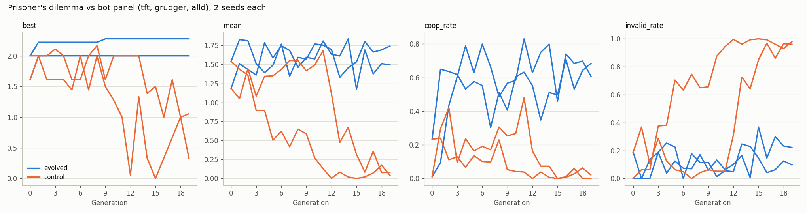

# Results log

Findings in the order they were made. Each entry gives the setup, what
happened, and what it means. Run data lives in `experiments/*/runs/` (not in
git); plans in `experiments/plans/`.

Model: Qwen2.5-0.5B-Instruct (bf16), LoRA r=4 on q_proj/v_proj, only B
matrices evolved (98k parameters per genome). Hardware: RTX 3050 Ti laptop, 4 GB.

---

## 1. Mutation size calibration (2026-10-27)

`experiments/calibrate_mutation.py`: 8 random mutants of the base genome per
noise level, scored on 32 Countdown puzzles and the 21 prisoner's dilemma
histories of up to 2 rounds.

| std | CD score | CD valid | CD changed | PD valid | PD changed |
|---|---|---|---|---|---|
| 0.002 | 0.105 | 98% | 11% | 100% | 0% |
| 0.005 | 0.116 | 98% | 12% | 100% | 0% |
| 0.01 | 0.113 | 99% | 22% | 100% | 0% |
| 0.02 | 0.082 | 97% | 50% | 100% | 1% |
| 0.035 | 0.074 | 76% | 81% | 100% | 49% |
| 0.05 | 0.052 | 49% | 92% | 76% | 24% |
| 0.1 | 0.010 | 0% | 100% | 13% | 100% |

- The original default (0.05) broke half of all Countdown outputs.
- Countdown sweet spot: 0.01-0.02. Prisoner's dilemma needs ~0.03 before
  behaviour changes at all; the base model defects in every situation and
  that prior is hard to shift.
- New defaults: Countdown initial 0.015 / per-generation 0.01; prisoner's
  dilemma initial 0.03 / per-generation 0.02.

## 2. Mutants can express history-dependent strategies, but rarely the right one

Inspecting individual mutants (std 0.025-0.04) found strategies such as
"cooperate first, then always defect", "always cooperate", and strategies
that react to the opponent's last move. Every reactive mutant seen so far
was *anti*-tit-for-tat (defect after the opponent cooperates, cooperate after
they defect).

In 160 mutants of the base model, none agreed with tit-for-tat on 75% or
more of histories, with or without an extra prompt line stating the
opponent's last move. Mutants of the evolved always-cooperate champion
(section 3) likewise produced no tit-for-tat-like strategies in 48 samples.

**Meaning:** what evolution can find is bounded by what small perturbations
of the model's prior can express. Flipping a default (D to C) is easy;
reciprocity is a rare neighbour.

## 3. Prisoner's dilemma vs a bot panel: selection steers and purifies

Plan `first_results`, runs `panel_evolved_s0` / `panel_control_s0`.
Genomes play only fixed bots (tit-for-tat, grudger, always-defect), 6 rounds
per match, population 16, 20 generations. Theoretical payoffs per round
against this panel: always-defect 1.44, always-cooperate 2.00, tit-for-tat 2.28.

Averages over the last 5 generations:

| run | mean payoff | cooperation | invalid moves | highest best |
|---|---|---|---|---|
| evolved, seed 0 | 1.45 | 0.64 | 0.25 | 2.00 |
| evolved, seed 1 | 1.69 | 0.61 | 0.09 | 2.28 |
| control, seed 0 | 0.18 | 0.01 | 0.92 | 2.17 |
| control, seed 1 | 0.06 | 0.02 | 0.97 | 2.00 |

Both seeds agree on the pattern below. Details are from seed 0.

- **Selection steers:** the evolved population went from 1% to 60-80%
  cooperation; its best genome is a clean always-cooperate (agrees with ALLC
  on 21/21 histories) scoring exactly the predicted 2.00.
- **Selection purifies:** in the control (random selection, same mutation),
  mutations accumulate unchecked. From generation 12 the population's outputs
  stop parsing (invalid rate 96-97% by generation 16-19) and mean payoff
  collapses to 0.08: mutational meltdown. The evolved population stays
  mostly functional (invalid 0-37%).
- **Premature convergence:** the evolved population sat at the ALLC ceiling
  (2.00) for 19 generations. The control briefly produced genomes scoring
  2.11 and 2.17, above that ceiling, which the converged population never did.
- **Mutation load grows:** the best genome's norm rose steadily (9 to 27) and
  the invalid rate drifted up, because nothing pulls genomes back.

## 4. Seed 1 evolved end-game defection

Run `panel_evolved_s1` (same settings as section 3, seed 1). The best genome
scored 2.28 from generation 9, equal to tit-for-tat's theoretical score, but
it is not tit-for-tat. Probing it one prompt at a time after n rounds of a
fixed history:

| history so far | move in rounds 1-10 |
|---|---|
| mutual cooperation | `CCCCCDDDDC` |
| I cooperate, opponent defects | `CCCCCDDDDD` |
| mutual defection | `CCCCCCDDDC` |

It cooperates unconditionally for five rounds, then defects from round 6,
which is the last round of every match it evolved in. The prompt says the
game lasts "an unknown number of rounds", so the model was never told the
horizon: selection found a round-counting strategy that exploits it. Against
the panel this earns (3.33 + 3.33 + 0.17) / 3 = 2.28, tying tit-for-tat by a
different route. Seed 0 stayed at plain always-cooperate (2.00).

**Meaning:** this is the end-game effect from game theory (defect when the
future can no longer punish you), reached by selection on weights rather
than by reasoning. It also shows that a fixed match length is an exploitable
cue; random match lengths would remove it.

**Caveat found along the way:** in bf16, batching prompts of different
lengths (left padding) can flip borderline greedy moves. Tournament batches
hold same-length prompts so runs are unaffected, but analysis tools now
generate one prompt at a time.

## 5. Countdown: no improvement at this budget (null result)

Runs `countdown/evolved_s0` / `control_s0`: population 12, 15 generations,
24 shared puzzles per generation, held-out set of 100.

| | gen 0 | gen 5 | gen 10 | gen 14 | mean fitness, all gens |
|---|---|---|---|---|---|
| evolved held-out accuracy | 6% | 6% | 6% | 4% | 0.096 |
| control held-out accuracy | 6% | 6% | 4% | 6% | 0.087 |

Evolved and control are indistinguishable; held-out differences are within
noise (about ±2.4 points on 100 puzzles). Both runs' fitness spikes at
generation 9, when the shared puzzle batch happened to be easy, so batch
difficulty dominates the fitness signal.

**Status: paused** (2026-10-28) to focus on the prisoner's dilemma.

**Meaning:** with 24 puzzles, one extra correct answer moves fitness by 0.04,
so selection mostly picks the luckiest genome (winner's curse). Unlike the
prisoner's dilemma, where a behaviour flip changes payoff a lot, Countdown
gives a weak signal per mutation. It needs a much larger evaluation set per
generation, or an easier task where the base model is nearer 30-50%.

## 6. Self-play: defection persists (the selfish outcome)

Runs `social_evolved_s0` / `social_control_s0`: population 12 playing every
other genome plus tit-for-tat and always-defect bots, 6 rounds, 15 generations.
Most of each genome's matches are against other genomes.

| | cooperation, gens 0-14 | mean payoff, last 5 gens | invalid, last 5 gens |
|---|---|---|---|
| evolved | 0-15% (ends at 0%) | 1.25 | 5% |
| control | 0-31% (ends at 6%) | 1.43 | 46% |

- **Evolved:** cooperators appear (15% in generation 1) but are exploited by
  the defecting majority and selected out; the population stays almost
  entirely defecting. This is the textbook result: in a population of
  defectors, a lone cooperator does worse.
- **Control:** "best" scores reach 3.71, but this is an artefact. Mutations
  break genomes (68% invalid by the end) and an invalid move counts as
  cooperation, so the remaining valid defectors score highly by exploiting
  broken neighbours. A higher mean payoff here reflects that exploitation,
  not better play.

**Meaning:** together with section 3, the same model and method evolve
cooperation against reciprocating bots and defection among themselves. The
social environment, not the model, decides what evolves.

## 7. Setup fixes (2026-10-28)

Changes prompted by sections 3-6. Results above were produced before them.

- **Unparseable moves count as defection** (and still score 0 for their
  player). Previously they counted as cooperation, which let working
  defectors exploit broken genomes (section 6's control).
- **Optional weight decay** (`--weight-decay`): each child is pulled a
  fraction of the way back to the base genome before mutation, bounding the
  build-up of mutations. Elites are copied unchanged. With mutation std 0.02
  and decay 0.15, per-element drift levels off around 0.02 / sqrt(1 - 0.85^2)
  = 0.038, inside the range where mutants change behaviour but stay valid.
- **Random match lengths** (`--rounds-max`): each generation's length is
  drawn uniformly from [rounds, rounds-max], removing the fixed last round
  that seed 1 exploited (section 4).

The base model still defects in every history after the prompt change.

## 8. Batch A: tit-for-tat does not evolve; agents ignore the opponent

Plan `batch_a_reciprocity`: bots tft + alld only (no self-play), match length
drawn from 4-10 once per generation, weight decay 0.15, population 16, 25
generations, 3 seeds each of evolved and control. At length 7, tit-for-tat
scores about 1.93, always-cooperate 1.50, always-defect 1.29.

Averages over the last 8 generations:

| run | mean payoff | cooperation | invalid | avg gap, coop vs tft minus vs alld |
|---|---|---|---|---|
| evolved s0 | 1.39 | 0.43 | 0.05 | 0.013 |
| evolved s1 | 1.38 | 0.54 | 0.06 | 0.014 |
| evolved s2 | 1.48 | 0.53 | 0.00 | 0.013 |
| control s0 | 1.18 | 0.18 | 0.17 | 0.007 |
| control s1 | 1.20 | 0.05 | 0.07 | 0.012 |
| control s2 | 1.19 | 0.19 | 0.12 | 0.017 |

- **Weight decay worked:** the best genome's norm levels off at about 11.9
  (it reached 27 without decay) and evolved runs end with 0-6% invalid moves.
- **Selection still beats the control** on payoff (1.38-1.48 vs 1.18-1.20)
  and cooperation, in all three seeds.
- **No reciprocity:** populations cooperate equally with tit-for-tat and with
  always-defect (gap about 1 point). The best genomes are always-cooperate
  (seeds 0 and 1) and "cooperate for two rounds, then defect" (seed 2): a
  third round-counting strategy, and no strategy that reads the opponent.
- **Design flaw:** one length per generation flips the best strategy
  between generations (short games reward early defection, long games
  reward cooperation), so selection chases the draw. Fixed afterwards with
  `--lengths-per-gen`: every pairing is played at several lengths each
  generation and fitness averages per match.

**Meaning:** across five evolved seeds (sections 3, 4 and 8), weight-noise
evolution of this LoRA finds strategies keyed to the round number, never
to the opponent's moves. Next question: can this LoRA represent
tit-for-tat at all (a representation limit), or can evolution just not
find it (a search limit)?

## 9. Tit-for-tat is representable: evolution's limit is search

`experiments/prisoners_dilemma/train_reference.py --strategy tft --batch 4
--steps 300 --lr 5e-4`: the same LoRA (rank 4, q/v, same fixed A matrices),
B matrices trained by gradient descent on tit-for-tat's move for random
histories of up to 9 rounds.

- Loss reached ~0 within 100 steps. The genome agrees with tit-for-tat on
  100% of held-out histories up to 9 rounds and 100% up to 15 rounds (longer
  than any it was trained on), with every move valid. Its fingerprint is
  textbook tit-for-tat.
- **Its norm is 2.0**, against about 9 for random generation-0 mutants and
  about 12 for evolved genomes.

**Meaning:** tit-for-tat is not just representable, it sits much closer to
the base model than anything evolution produced. Evolution misses it because
it is one specific direction among 98k parameters and Gaussian noise
almost never points that way. The bottleneck is the search, not the
representation. This genome is saved as `runs/reference_tft/best.pt`
(regenerate with the command above) and used as the reciprocator in Batch B.

## Open questions and next ideas

- Self-play with more reciprocating bots, or an initial cluster of
  cooperators, to test whether cooperation can invade (the classic result
  is that it needs a threshold of reciprocators).
- Score invalid moves as defection, or penalise them more, so broken
  genomes can't be exploited in self-play.

- Random match lengths (e.g. geometric, mean 6) to remove the end-game cue;
  this should leave reciprocity as the only way past 2.00.
- Countdown: 128+ puzzles per generation (cost scales linearly), or a
  task the base model half-solves, before concluding anything about it.

- Weight decay towards the base genome each generation, to bound mutation
  load (tests whether the invalid-rate drift goes away).
- More exploration once converged: larger population, fewer elites, or
  fitness sharing / novelty for behaviourally distinct genomes.
- Stronger pressure for reciprocity: a panel of tft + alld only makes
  tit-for-tat's advantage over always-cooperate 0.42 instead of 0.28.
